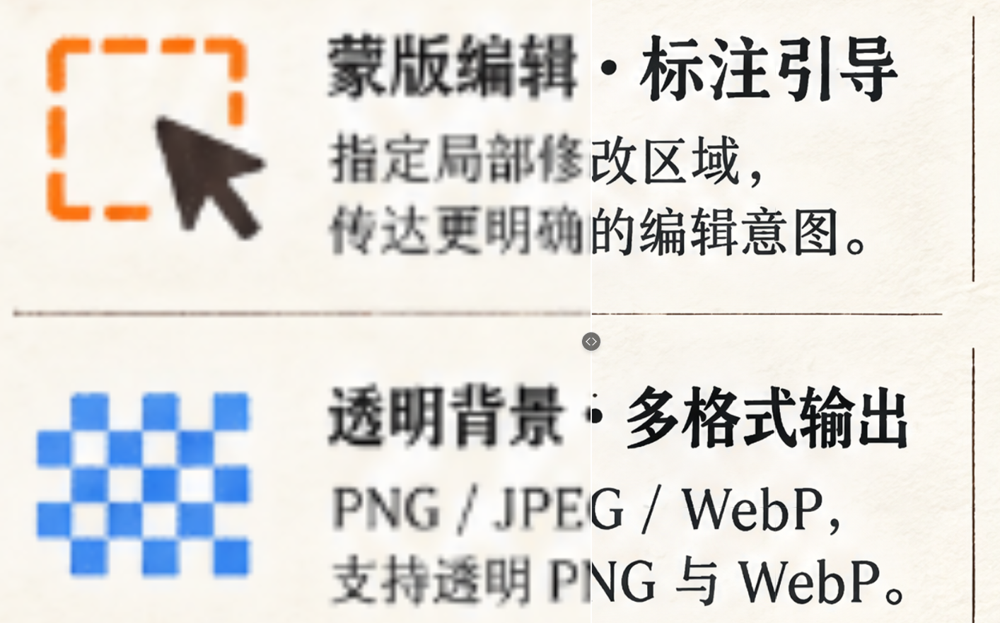

# tiled-image-upscale

独立的 AI 分块放大 Skill / Node.js 命令行工具：**重叠裁剪 → 逐块图生图 → 小范围平移校正 → 低频颜色约束 → 羽化拼接**。

一个用于 AI 图像分块放大的 Skill，支持多倍率放大、任务恢复与结果拼接。可由 Codex 等支持本地脚本的 AI 客户端调用，也可通过 Node.js 命令行运行。

> AI 生成可能改变文字、纹理和局部结构。请检查最终结果；本技能不承诺无损恢复或完全无缝。

## 要求与许可证

- Node.js **20.9+**，推荐 Node.js 22 / 24；npm；支持 sharp 原生依赖的平台。
- 本项目采用 [MIT](LICENSE)，允许商业使用、修改及再分发，须保留版权和许可声明。
- 在线生图依赖外部 **image-gen** 技能，本仓库不附带其代码或为其授予许可。安装来源及授权由用户自行核实。
- 生图服务不是免费的模型权重；在线请求可能收费，需要用户自己的服务账号及 `IMAGE_GEN_API_KEY`。

## 安装

下载仓库或解压发布包到一个专用目录，在该目录运行：

```sh
npm ci --omit=dev
```

如供 Codex 使用，将目录内容放在用户技能目录 `~/.codex/skills/tiled-image-upscale/`，再运行上述安装命令。Windows 的 `~` 对应当前用户目录。安装后新建聊天，以便客户端发现技能。其他客户端使用各自的技能安装目录。

生图由外部 **image-gen** 技能完成：本项目不打包、不代理、也不背书任何供应商或中转服务，你可以接入任何符合接口约定的实现。具体要求见 [安装说明](INSTALL.md)。

推荐目录结构：

```text
skills/
  tiled-image-upscale/
    SKILL.md
    scripts/
    package.json
  image-gen/
    SKILL.md
    scripts/node/image-gen.js
```

不按同级结构安装时，在 prepare 中明确传入 `--provider-script`。详见 [安装说明](INSTALL.md)。

## 快速开始

以下命令在技能目录运行；将占位路径换成实际路径。**工作目录建议放在仓库外**，每个任务独立建目录。

### 1. 离线准备：先看分块数

```sh
node scripts/tiled-upscale.cjs prepare --input "原图.png" --scale 4 --work-dir "任务目录" --provider-script "<image-gen>/scripts/node/image-gen.js"
```

查看 `target`、`total` 和 `estimatedNewRequests`；prepare 只处理本地图像，不发送生图请求。支持 2、3、4、6、8、10 倍，默认2倍；输出最多1亿像素、最长边20000、最多256块。

### 2. 在线生成：确认费用后再执行

先配置自己的环境变量，不把密钥写入代码、命令参数或仓库。

```sh
node scripts/tiled-upscale.cjs generate --work-dir "任务目录" --max-new 6
```

`--max-new` 是本轮新提交的数量上限，不是金额上限。默认模型 `gpt-image-2.5-sunburst`，请求2048方图 / high；模型需服务商实际支持。本技能逐块处理，不提供并发参数，也不自动更换模型或自动重试。

### 3. 拼接导出

```sh
node scripts/tiled-upscale.cjs stitch --work-dir "任务目录" --output "成品.png"
```

如果实际分块小于目标大小，默认会插值并给出 warning。禁止插值时添加 `--no-interpolation`。已有成品默认不覆盖；明确需要时再使用 `--overwrite`。

**请求2048不等于返回2048，输出4倍像素不等于获得原生4倍生成细节。**

## 离线导入与恢复

```sh
node scripts/tiled-upscale.cjs status --work-dir "任务目录"
node scripts/tiled-upscale.cjs import --work-dir "任务目录" --tile r1c1 --image "已生成分块.png"
```

- 仅裁剪、导入及拼接时，不需要密钥或在线服务。
- 导入的块必须对应 manifest 中记录的视野和布局；同名文件不代表可互换。导入不证明模型来源。
- 缺块时拒绝最终导出，不拿原图填补后冒充完整 AI 放大。
- 缓存会核对哈希、图像和请求配置；换原图、模型或倍率须使用新工作目录，不要手改 manifest。
- 请求状态不确定时保留 `inFlight`；优先查供应商、导入已有结果。`--retry-uncertain` 可能重复计费，只在明确决定后使用。
- Ctrl+C 不再提交下一块，但远端已受理请求可能继续生成并收费。不要直接删除锁或在运行中移动任务目录。

完整技能指引见 [SKILL.md](SKILL.md)，常见问题见 [FAQ](docs/FAQ.md)。

## 效果和示例



插画 8× 分块放大：原图 768×1024 → 输出 6144×8192（约 5033 万像素），模型 `gpt-image-2.6-sunburst`、生成分辨率设置 4K。上图为缩放显示的前后对比。

完整素材（原图、成品、另一处局部对比、参数记录）见 [examples/demo-01](examples/demo-01/NOTES.md)。

⚠️ 对比请查看**原尺寸局部**：本版包含平移、颜色和羽化处理，但无法保证模型重绘后结构一致、文字正确或完全无缝。**请求 2048 不等于返回 2048，输出 4 倍像素也不等于获得原生 4 倍生成细节。** 单图是案例，不是质量排行榜，也不能证明在线供应商可用。

示例图片由维护者本人提供并按 MIT 许可一并发布；新增案例要求见 [examples](examples/README.md)。

## 开发与验证

```sh
npm ci
npm run check
npm test
npm audit --omit=dev
```

测试使用合成图片和本地模拟供应商，不需要真实密钥，不访问在线生图服务。GitHub Actions 覆盖 Windows / Linux 和 Node.js 22 / 24，当前 4/4 通过；通过范围仅限该矩阵，不代表所有平台。证据见 [验证记录](docs/VERIFICATION.md)。

## 安全与依赖

- 不提交 `.env`、真实密钥、工作目录、接口原始响应及生成缓存。
- 调用回执可能含图像 base64、路径或供应商信息。即使已遮盖传入的专用密钥，也不代表所有可能的隐私都已自动消除。
- 对异常响应只保守恢复“完成图片 + 截断的空 usage 对象”，完整解码后仍进入原有图像验收；不放行任意坏 JSON。
- 依赖许可见 [第三方说明](THIRD_PARTY_NOTICES.md)，风险报告见 [SECURITY.md](SECURITY.md)。

本项目与 OpenAI/Codex 或所用生图供应商不存在官方背书关系。软件许可不替代服务条款、图片版权或商标授权。


