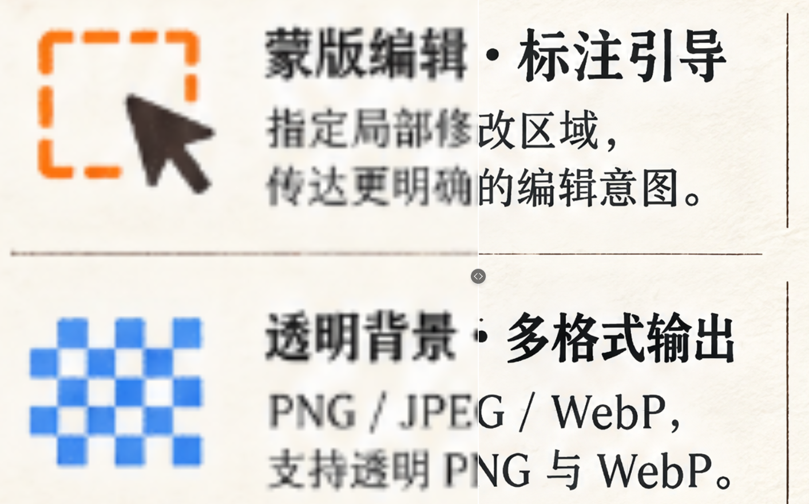

# 示例素材

本目录收录由维护者使用本技能生成、并有权公开的效果案例。

| 案例 | 内容 | 参数 |
|---|---|---|
| [demo-01](demo-01/NOTES.md) | 插画 8× 分块放大，含原图、成品与两张局部对比 | `gpt-image-2.6-sunburst` · 4K · 8× · 768×1024 → 6144×8192 |

## 授权与来源

- 所有图片由维护者本人提供，按本仓库 [MIT 许可](../LICENSE) 一并发布，仅用于展示本工具效果。
- 图片素材本身的权利归其作者所有；MIT 许可覆盖本仓库中的代码与文档，不替代对图片内容可能的商标、肖像或其他第三方权利。
- 新增案例前请确认有权公开原图与生成图，并为每个素材标注来源与许可。不要把用户私密数据、原始接口日志或工作目录打包进仓库。

## 新增案例的建议字段

- 原图、最终结果，以及相同输出尺寸的普通 Lanczos 插值基线。
- 全图与 100% 局部并排对比；明确左右次序与是否缩放显示。
- 倍率、模型、请求尺寸/质量、真实返回尺寸、参考图数量、分块布局、提示词。
- 请求次数、缓存复用、异常恢复、是否插值和费用来源（不披露密钥）。
- 检查文字、接缝、颜色、结构与纹理；展示失败或局限，不只挑最好结果。

没有高分辨率真值时不使用 PSNR/SSIM 证明质量更好。单图是案例，不是普遍性能基准。
